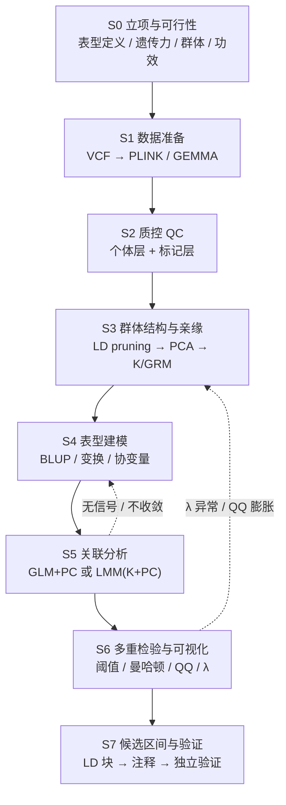

# 技术路线（8 阶段）

> 依据 Mills, Barban & Tropf (2020) 第 3、4、8、9、12 章；`PDF pNNN` 为扫描版页码。完整版（含植物表型适配矩阵）见交付文档《技术路线_WGS×植物表型关联分析.md》。

## 流程图

原书 Figure 4.1（PDF p97）的流程：可行性评估 → 组建协作与数据协议 → 预注册分析计划 → 统一数据格式与汇总统计 → 各中心独立 QC → 优先信号与独立样本复现 → 生物学注释与功能变异追踪。本路线把「预注册」落地为冻结 `project_config.yaml`，把「各中心独立 QC」落地为双人复核的质量门禁。

---

## S0 立项与可行性

- 明确表型是单次测量值还是多环境校正后的遗传值。
- 查已有遗传力、已知 QTL/基因（PDF p96 建议先评估 heritability 与表型可得性）。
- 功效评估：效应量、样本量、功效联动（PDF p105）。N<200 时目标应定为「候选区间 + 可验证假设」。
- **冻结配置**：物种、参考基因组、群体类型、表型列、协变量、阈值写入配置快照。

## S1 数据准备

- 起点 VCF（PDF p191）；转换到 PLINK binary（PDF p170–171）或 GEMMA 输入。
- 统一染色体命名与参考基因组版本；合并批次 VCF 前统一 ref/alt 与等位基因方向（PDF p210）。
- 记录原始 VCF 的 MD5、样本重命名表、缺测个体清单。

## S2 两层质控

个体层：`--mind`、杂合度 `--het`、重复/近亲 IBS、`--check-sex`（植物改为倍性/污染检查）。
标记层：`--geno`、`--maf`、`--hwe`（植物慎用）、WGS 特有的 DP/GQ/等位基因平衡、批次差异缺失。
详细参数与命令见 `qc-parameters.md`。产出 `qc_report.md`，记录每步过滤前后计数与剔除原因。

## S3 群体结构与亲缘

1. **先 LD pruning**：`--indep-pairwise W S r²`（常用 50 5 0.2），得到独立标记集（PDF p241–243）。植物 LD 衰减距离差异大，窗口按物种实测调整。
2. **PCA**：只用独立标记，`--pca 10`；常用前 10 或 20 个 PC（PDF p245）。用 PCA 图与已知亚群/批次对照决定 PC 数（Figure 9.2，PDF p247）。
3. **K / GRM**：PLINK `--make-rel`、`--distance`（IBS，PDF p253–254）或 GCTA `--make-grm`（PDF p255–256）；必要时 `--grm-cutoff 0.025`。
4. **模型路线**：见 `model-selection.md`。原书 PDF p248 明确混合线性模型已逐渐取代单纯 PCA 校正。
5. 顺带估计 SNP 遗传力（GCTA GREML，PDF p195、p256–257；LDSC，PDF p341）。

## S4 表型建模

多环境先取 BLUP/BLUE；按类型做变换；协变量只放先于表型、不由基因型决定的变量；检查共线性。详见 `phenotype-cookbook.md`。

## S5 关联分析

- 数量性状 `--linear`，二分类 `--logistic`（PDF p236–237）；默认加性模型，必要时检验显性/隐性（PDF p238）。
- 协变量 `--covar`（PDF p238）。
- 每个表型单独跑，**共享同一套 QC 后基因型、PC、K 矩阵**——这是不同方向结果可比的前提。
- 效应量与 p 值必须同时报告（PDF p101）。
- 多表型可用 MTAG 联合分析或 LDSC 遗传相关（第 12 章，PDF p332 起）。

## S6 多重检验与诊断

- 100 万个 SNP 用 p<0.05 会产生约 5 万假阳性（PDF p239）。
- 阈值：`p<5e-8`（书中标准，PDF p101–102）；WGS 高密度标记建议 Bonferroni `0.05/M_eff`、FDR 或置换经验阈值并写明依据。
- 曼哈顿图（PDF p102、p333–336）：x=基因组位置，y=−log₁₀(p)，加显著线；成片高点是 LD 块。
- Q-Q 图与 λ（PDF p337–340）：λ≈1 表示校正充分，λ>1.2 提示残余结构（案例 λ=1.239）；但高度多基因性状本身也会抬高 λ，不可单凭 λ 判定。
- 区域关联图（LocusZoom，PDF p337）放大显著区间。
- 门禁不通过 → 回退 S3 或 S2，**不得放宽阈值掩盖**。

## S7 候选区间与验证

- 以「领先 SNP + 局部 LD 块」定义候选区间，宽度取该物种 LD 衰减距离，而非单 SNP。
- 注释：基因模型、变异后果、已知 QTL 共定位、同源基因、GO/KEGG、eQTL/表达、单倍型。
- 验证优先序：独立群体复现 → 已知基因/突变体/近等基因系 → 表达或代谢证据 → 基因编辑。
- 结论边界：关联 ≠ 因果；效应不可跨群体/祖先直接搬用（PDF p59、p127）。

---

## 质量门禁

| 阶段 | 通过条件 |
| --- | --- |
| S1 | VCF 可解析、坐标版本一致、样本 ID 与表型 100% 可匹配 |
| S2 | 过滤前后计数有记录、无批次特异缺失断层、无大量样本因同一原因被剔除 |
| S3 | PCA 前已 LD pruning、PC 数有依据、K 矩阵无 NaN 且正定 |
| S4 | 表型分布已检查、多环境已 BLUP、协变量无强共线 |
| S5 | 模型收敛、效应量/SE/p 齐全、阳性对照能复现 |
| S6 | λ 在 1.0–1.2 且 QQ 无整体膨胀、阈值写明依据、显著峰与 LD 一致 |
| S7 | 候选区间有注释与 LD 依据、至少一项独立证据、结论不超出关联推断 |

## 可迁移性

所有可变项集中在 `assets/project_config.yaml`。换方向只改 `phenotypes` 与 `threshold`；换物种/群体再加改 `species`、`population`、`ld_pruning`、`qc`。`SKILL.md` 的工作流与硬约束不随单个课题改动。
